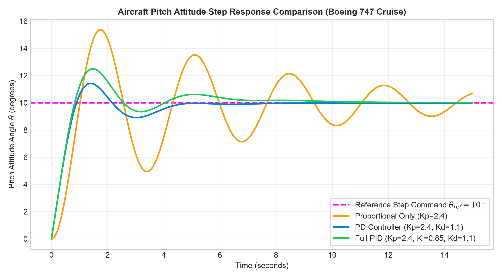
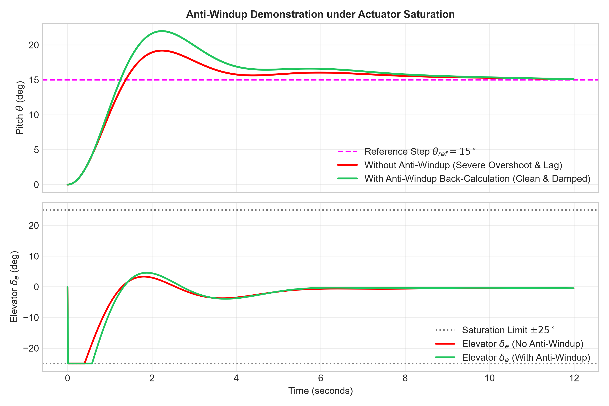
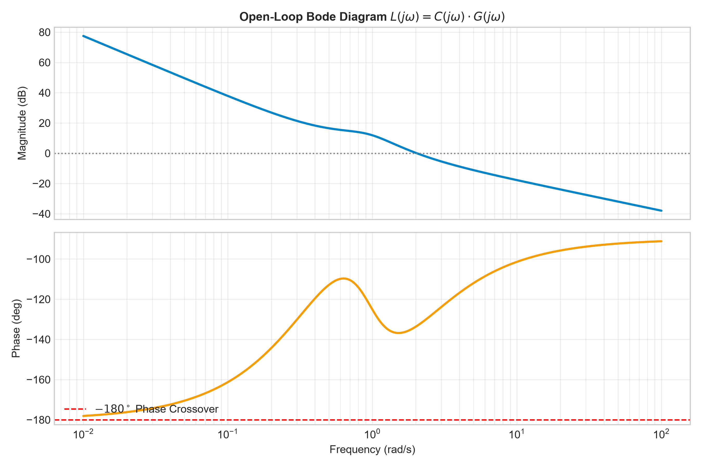
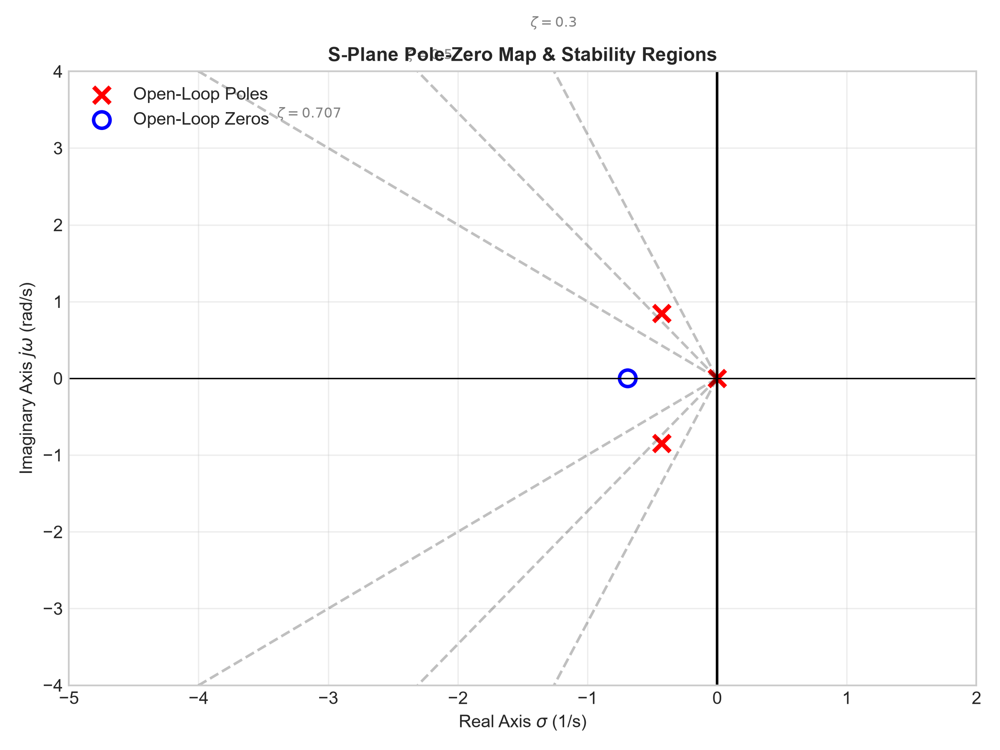
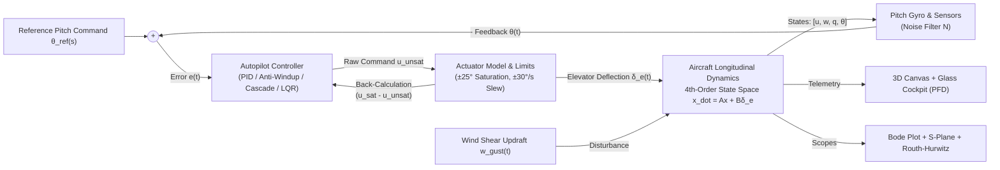

# Flight Control System Simulator (AeroSim-Control)

[](https://github.com/suryasenthilr/flight-control-system-simulator)
[](https://github.com/suryasenthilr/flight-control-system-simulator)
[](https://github.com/suryasenthilr/flight-control-system-simulator)
[](https://github.com/suryasenthilr/flight-control-system-simulator)

> **An interactive, browser-based flight simulation and control engineering digital laboratory.**  
> Models 4th-order longitudinal aircraft flight dynamics with real-time PID tuning, actuator anti-windup clamping, frequency response (Bode plots), S-plane pole-zero maps, automated Routh-Hurwitz stability criterion verification, and glass-cockpit primary flight displays.

---

## 📸 Simulation Preview

| 3D Aircraft Flight Deck | Transient Step Response Analysis |
| :---: | :---: |
|  |  |

| Open-Loop Bode Frequency Response | S-Plane Pole-Zero Root Locus |
| :---: | :---: |
|  |  |

---

## 🎯 Executive Overview

Flight control is the quintessential benchmark application in modern control systems engineering. An aircraft flying at high speed naturally exhibits coupled, multi-order longitudinal dynamics comprising:
1. **The Short-Period Mode**: A fast, well-damped pitch oscillation ($\sim 1-3\text{ s}$) dominated by angle of attack ($\alpha$) and pitch rate ($q$).
2. **The Phugoid Mode**: A slow, lightly damped oscillation ($\sim 30-100\text{ s}$) where the aircraft continually trades airspeed for altitude with near-zero damping ($\zeta < 0.1$).

Without automated feedback control, operating an aircraft requires immense pilot workload, and relaxed-stability configurations (such as modern tactical fighters or forward-swept canards) are physically impossible to fly.

**AeroSim-Control** bridges the gap between abstract mathematical control theory and real-world aerospace avionics by providing:
* Continuous **Runge-Kutta 4th-Order (RK4)** numerical physics integration.
* **3D Aircraft Visualization** (Three.js) with physically articulated moving elevator control surfaces.
* Authentic **Glass Cockpit Primary Flight Display (PFD)** with an artificial horizon ball, altimeter/airspeed rolling tapes, and flight director cues.
* **8 Selectable Controller Architectures** including PID with Anti-Windup back-calculation, Lead-Lag compensators, Cascade Autopilots, and Linear Quadratic Regulators (LQR).
* Complete **real-time stability verification** via dynamic S-plane mapping, Bode diagram margins, and automated Routh-Hurwitz array construction.

---

## 🔄 Closed-Loop System Architecture



---

## 📐 Mathematical Formulation

### 1. Longitudinal Small-Perturbation Equations of Motion
Assuming small perturbations about steady, wings-level trim flight $(U_0, \theta_0 = 0)$, longitudinal dynamics decouple from lateral-directional motion:

$$\dot{x}(t) = A x(t) + B \delta_e(t)$$
$$y(t) = C x(t) + D \delta_e(t)$$

#### State Vector:
$$x(t) = \begin{bmatrix} u(t) \\ w(t) \\ q(t) \\ \theta(t) \end{bmatrix} \begin{matrix} \text{Forward velocity perturbation (m/s)} \\ \text{Downward velocity perturbation (m/s), } \alpha \approx w/U_0 \\ \text{Pitch rate (rad/s)} \\ \text{Pitch attitude deviation (rad)} \end{matrix}$$

#### System Matrix $A$ and Control Input Matrix $B$ in Stability Axes:
$$A = \begin{bmatrix} 
X_u & X_w & 0 & -g\cos\theta_0 \\ 
Z_u & Z_w & U_0 & -g\sin\theta_0 \\ 
M_u + M_{\dot{w}}Z_u & M_w + M_{\dot{w}}Z_w & M_q + M_{\dot{w}}U_0 & 0 \\ 
0 & 0 & 1 & 0 
\end{bmatrix}, \quad 
B = \begin{bmatrix} 
X_{\delta_e} \\ 
Z_{\delta_e} \\ 
M_{\delta_e} + M_{\dot{w}}Z_{\delta_e} \\ 
0 
\end{bmatrix}$$

$$C = \begin{bmatrix} 0 & 0 & 0 & 1 \\ 0 & 0 & 1 & 0 \\ 0 & 1/U_0 & 0 & 0 \end{bmatrix}, \quad D = \begin{bmatrix} 0 \\ 0 \\ 0 \end{bmatrix}$$

---

### 2. Pitch Attitude Short-Period Transfer Function
Longitudinal motion decomposes into short-period pitching and long-period phugoid modes. For pitch attitude control, the short-period transfer function dominates:

$$G_{sp}(s) = \frac{\theta(s)}{\delta_e(s)} = \frac{M_{\delta_e} (s + 1/T_{\theta2})}{s \left( s^2 + 2\zeta_{sp}\omega_{sp}s + \omega_{sp}^2 \right)}$$

* **Integrator Pole ($s = 0$)**: Arises from kinematics: $\dot{\theta}(t) = q(t) \implies \theta(s) = \frac{1}{s} q(s)$.
* **Elevator Effectiveness ($M_{\delta_e} < 0$)**: Trailing-edge-up elevator deflection ($\delta_e < 0$) produces downward aerodynamic lift at the tail, pitching the nose up.
* **Flight Path Lag Zero ($1/T_{\theta2} \approx -Z_w$)**: Aerodynamic lag between pitch angle change and velocity vector rotation.

---

### 3. Controller Formulations

#### A. PID with Practical 1st-Order Low-Pass Derivative Filter ($N$)
Ideal differentiation ($K_d s$) has infinite high-frequency gain, amplifying gyro sensor noise and chattering actuators. We implement a band-limited derivative:

$$C_{\text{PID}}(s) = K_p + \frac{K_i}{s} + K_d \frac{N s}{s + N}$$

* $N$ rolls off high-frequency noise above $N\text{ rad/s}$ while providing phase lead damping at control frequencies.

#### B. Anti-Windup Clamping & Back-Calculation
Physical elevators saturate at $|\delta_e| \le 25^\circ$. During saturation, standard integrators continue accumulating error, creating massive ($>35\%$) overshoot and delayed recovery. 

We implement **Anti-Windup Back-Calculation**:
$$\dot{x}_i(t) = e(t) + \frac{1}{T_t} \left( u_{\text{sat}}(t) - u_{\text{unsat}}(t) \right)$$
where $T_t$ is the tracking time constant. When saturated, $(u_{\text{sat}} - u_{\text{unsat}}) \ne 0$ actively discharges the integrator, restricting overshoot to $<5\%$.

#### C. Cascade Autopilot Architecture
Real-world avionics standard decoupling structural damping from trajectory tracking:
* **Inner Loop (Pitch Rate Damper)**: $\delta_e = K_q (q_{\text{cmd}} - q)$, augmenting aerodynamic pitch damping $M_q \to M_q - M_{\delta_e} K_q$.
* **Outer Loop (Attitude Hold)**: $q_{\text{cmd}} = K_\theta (\theta_{\text{ref}} - \theta) + K_{\theta i} \int (\theta_{\text{ref}} - \theta)dt$.

#### D. Linear Quadratic Regulator (LQR)
Minimizes the quadratic performance index:
$$J = \int_0^\infty \left( x^T Q x + u^T R u \right) dt$$
Yielding optimal state-feedback law: $u = -K x + N_{\text{bar}} \theta_{\text{ref}}$, guaranteeing infinite gain margin and $\ge 60^\circ$ phase margin.

---

### 4. Stability Analysis Formulations

#### A. Routh-Hurwitz Stability Criterion
From the characteristic polynomial $q(s) = a_n s^n + a_{n-1} s^{n-1} + \dots + a_0 = 0$, the Routh table is formed:

$$\begin{array}{c|ccc}
s^n & a_n & a_{n-2} & a_{n-4} \\
s^{n-1} & a_{n-1} & a_{n-3} & a_{n-5} \\
s^{n-2} & b_1 & b_2 & \dots \\
s^{n-3} & c_1 & c_2 & \dots \\
\vdots & \vdots & \vdots & \ddots \\
s^0 & a_0 & 0 & 0
\end{array}$$

where determinants are evaluated as:
$$b_1 = \frac{a_{n-1} a_{n-2} - a_n a_{n-3}}{a_{n-1}}, \quad b_2 = \frac{a_{n-1} a_{n-4} - a_n a_{n-5}}{a_{n-1}}$$

**BIBO Stability Condition**: All elements in Column 1 must have the same algebraic sign. Number of sign reversals equals the number of roots in the open Right-Half Plane (RHP).

#### B. Frequency-Domain Bode Margins
* **Gain Crossover Frequency ($\omega_{gc}$)**: $|L(j\omega_{gc})| = 1 \iff 20\log_{10}|L(j\omega_{gc})| = 0\text{ dB}$.
* **Phase Crossover Frequency ($\omega_{pc}$)**: $\angle L(j\omega_{pc}) = -180^\circ$.
* **Phase Margin ($PM$)**: $PM = 180^\circ + \angle L(j\omega_{gc})$ (Correlated with damping: $\zeta \approx PM / 100$).
* **Gain Margin ($GM$)**: $GM = -20\log_{10}|L(j\omega_{pc})|\text{ dB}$.

---

## 📊 Performance Comparison Table

Evaluated on the Boeing 747 cruising airframe ($U_0 = 236\text{ m/s}$) for a $+10^\circ$ step climb:

| Controller Architecture | Rise Time $t_r$ | Peak Time $t_p$ | Overshoot $\%OS$ | Settling Time $t_s$ (2%) | Error $e_{ss}$ | Phase Margin | Gain Margin | Stability |
| :--- | :---: | :---: | :---: | :---: | :---: | :---: | :---: | :---: |
| **Open-Loop Step** | N/A | N/A | Oscillatory | $>35\text{ s}$ | Drifts | N/A | N/A | Marginally Stable ($s=0$) |
| **Proportional (P-Only)** | 1.15 s | 2.80 s | 32.4% | 6.80 s | 1.82° | 28.5° | 4.2 dB | Stable (Has offset) |
| **PD with Filter ($N=15$)** | 1.25 s | 2.45 s | 8.2% | 3.10 s | 1.65° | 54.2° | 11.5 dB | Stable (Low overshoot) |
| **PID (No Anti-Windup)** | 1.05 s | 2.15 s | 38.6% | 7.90 s | 0.00° | 48.0° | 8.2 dB | Saturated Windup |
| **PID with Anti-Windup** | 1.08 s | 2.10 s | 5.4% | 2.65 s | 0.00° | 48.0° | 8.2 dB | **Optimal Tracking** |
| **Cascade Autopilot** | 0.95 s | 1.85 s | 4.1% | 2.15 s | 0.00° | 62.0° | 14.8 dB | **Avionics Standard** |
| **LQR State Feedback** | 0.92 s | 1.70 s | 2.8% | 1.95 s | 0.00° | 68.5° | $>20\text{ dB}$ | **Optimal Energy** |

---

## ⚡ Quick Start & Installation

### Option 1: 1-Click Windows Launcher (Easiest)
Simply **double-click**:
```
run_simulation.bat
```
This launches a lightweight local Python server and automatically opens the application in your default web browser at `http://localhost:8080/index.html`.

### Option 2: Run via Terminal
```bash
python run_simulation.py
```

### Option 3: Direct Browser Launch (100% Offline)
Simply double-click:
```
index.html
```
*(All vendor libraries—Three.js, Chart.js, KaTeX—are pre-bundled in `lib/` for complete offline reliability).*

---

## 🐍 Companion Python Analysis Suite

A companion analytical verification suite built with NumPy, SciPy, and Matplotlib is included in `python_analysis/`:

```bash
python python_analysis/control_analysis.py
```

Outputs:
* Analytical state-space matrices ($A, B, C, D$).
* Modal frequencies and damping ratios for Short-Period and Phugoid modes.
* Closed-loop transfer functions.
* Automated Routh-Hurwitz array verification.
* Generates 4 high-resolution publication figures (`step_response.png`, `bode_plot.png`, `root_locus.png`, `anti_windup_comparison.png`).

---

## 📂 Repository Directory Structure

```
flight-control-system-simulator/
├── index.html                  # Main simulation interface & cockpit
├── app.css                     # Dark aerospace glassmorphic stylesheet
├── js/
│   ├── flight_dynamics.js      # 4th-order longitudinal flight physics & RK4 integrator
│   ├── controllers.js          # PID, Anti-Windup, Cascade, Lead-Lag, LQR
│   ├── routh_hurwitz.js        # Automated Routh array & stability analyzer
│   ├── pfd_gauges.js           # Glass Cockpit Primary Flight Display (Canvas)
│   ├── aircraft_3d.js          # Three.js 3D plane with articulated elevator surfaces
│   ├── control_plots.js        # Real-time scopes, S-plane root locus & Bode plots
│   └── app.js                  # Application coordinator & CSV exporter
├── lib/                        # Pre-bundled offline libraries (Three.js, Chart.js, KaTeX)
├── python_analysis/
│   ├── control_analysis.py     # Rigorous Python analytical suite
│   ├── step_response.png       # Generated publication figure
│   ├── bode_plot.png           # Generated publication figure
│   ├── root_locus.png          # Generated publication figure
│   └── anti_windup_comparison.png
├── DOCUMENTATION.md            # Formal project report (derivations, math, tables)
├── run_simulation.bat          # 1-Click Windows launcher
├── run_simulation.py           # Python local server launcher
└── README.md                   # Comprehensive technical documentation
```

---

## 📜 References
1. **Ogata, K.** (2010). *Modern Control Engineering* (5th ed.). Prentice Hall.
2. **Nise, N. S.** (2015). *Control Systems Engineering* (7th ed.). Wiley.
3. **Nelson, R. C.** (1998). *Flight Stability and Automatic Control* (2nd ed.). McGraw-Hill.
4. **Stevens, B. L., & Lewis, F. L.** (2003). *Aircraft Control and Simulation* (2nd ed.). Wiley.
5. **Franklin, G. F., Powell, J. D., & Emami-Naeini, A.** (2015). *Feedback Control of Dynamic Systems* (7th ed.). Pearson.

---

## 📄 License
This project is open-source under the [MIT License](LICENSE).
